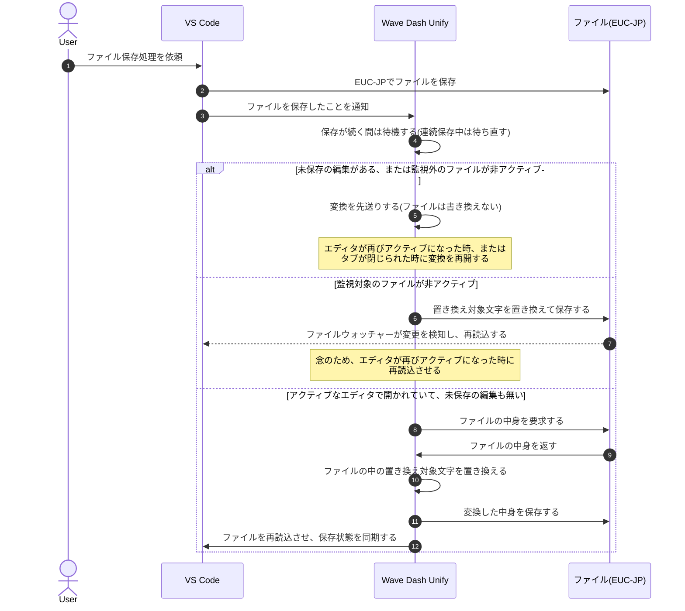

# 内部設計

このドキュメントは、Wave Dash Unify の内部の処理フローや判定ロジックについてまとめたものです。拡張機能の使い方については [README](../README.md) を参照してください。

## 保存時の処理フロー

VS Code ではファイルの文字コードに EUC-JP を指定した状態で`～`という文字を保存した際に一般的に使われる波ダッシュ(0xA1 0xC1)ではなく、全角チルダ(0x8F 0xA2 0xB7)で保存されます。

そのため、VS Code で`～`を含まれる EUC-JP のファイルを編集した際に他のツールでファイルを閲覧すると文字化けするといった問題が発生します。

この拡張機能をインストールすると、EUC-JP のファイルを保存した時に全角チルダ(0x8F 0xA2 0xB7)を波ダッシュ(0xA1 0xC1)に変更し、前述の文字化け問題を回避します。

その他置き換え対象文字についても、同様の処理を行います。

おおまかな処理は以下の通りです。

連続して保存された場合に待機するのは、保存の直後にファイルを書き換えると VS Code の保存処理と競合してしまうためです。

同じ理由で、変換後のファイル状態は VS Code に同期させる必要があります。同期の手段(再読込コマンド)はアクティブなエディタにしか効きません。ただし、ワークスペース内のファイルは VS Code のファイルウォッチャーが監視しており、非アクティブなタブでもディスクの変更を検知して再読込します。そのため「すべて保存」や自動保存で非アクティブなタブが保存された場合も、ワークスペース内のファイルはすぐ変換します。

ワークスペース外のファイルと、`files.watcherExclude` で監視から外したファイルは再読込されないため、エディタが再びアクティブになったタイミングやタブが閉じられたタイミングまで変換を待ちます。この間、ファイルはディスク上では未変換(全角チルダなどを含む正当な EUC-JP ファイル)のままです。

## EUC-JP 判定ロジック

VS Code 1.100.0 以降では、VS Code 自身が持つエンコーディング情報(`TextDocument.encoding` API)を使って EUC-JP を判定します。この API があれば、ユーザーが「エンコーディング付きで再度開く」で明示的に指定した内容もそのまま反映されます。

1.100.0 より前のバージョンにはこの API が無いため、ファイルのバイト列から EUC-JP かどうかを推定します。この推定には次の限界があります。

- EUC-JP と同じバイト構造を持つ他のマルチバイトエンコーディング(GBK など)のファイルを、EUC-JP と誤判定する可能性がわずかにあります
- ユーザーが VS Code 上で指定したエンコーディングは判定に反映されません
- 保存時に、エンコーディングを問わず一度ファイル全体を走査するため、大きなファイルでは 1.100.0 以降より保存後の処理が重くなります

いずれも 0.3 系までと同じ挙動です。1.100.0 以降ではこの推定を行いません。
